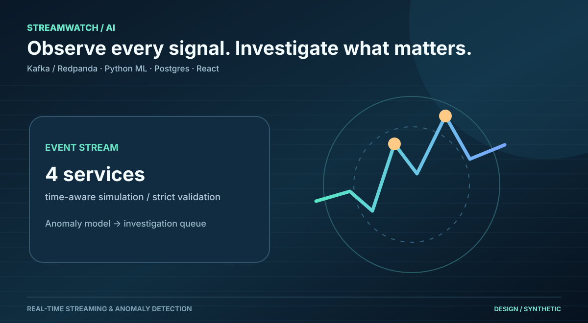
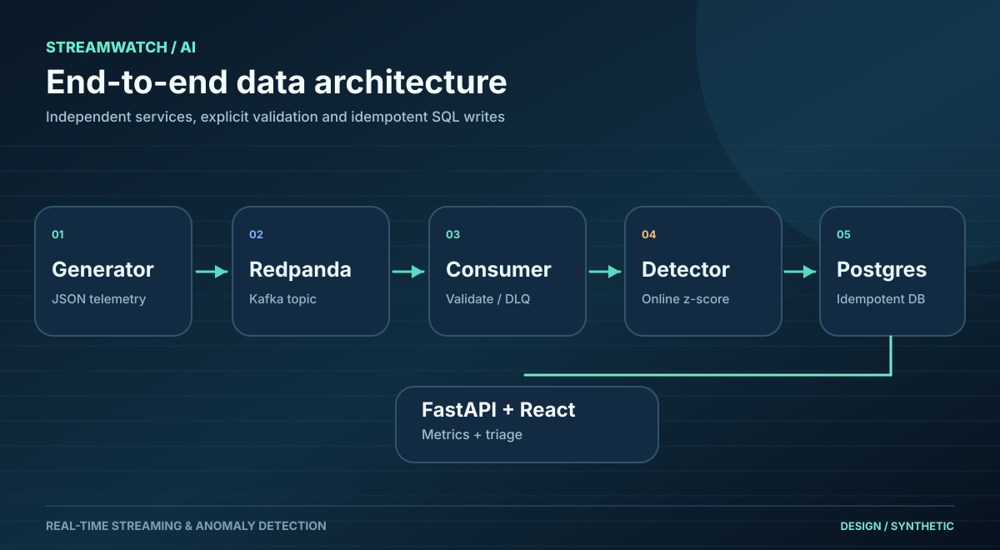
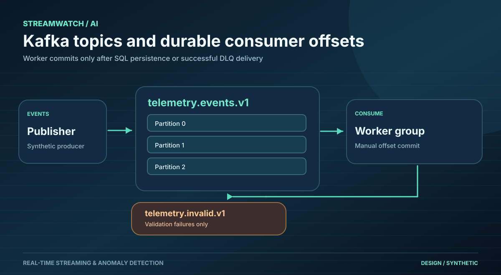
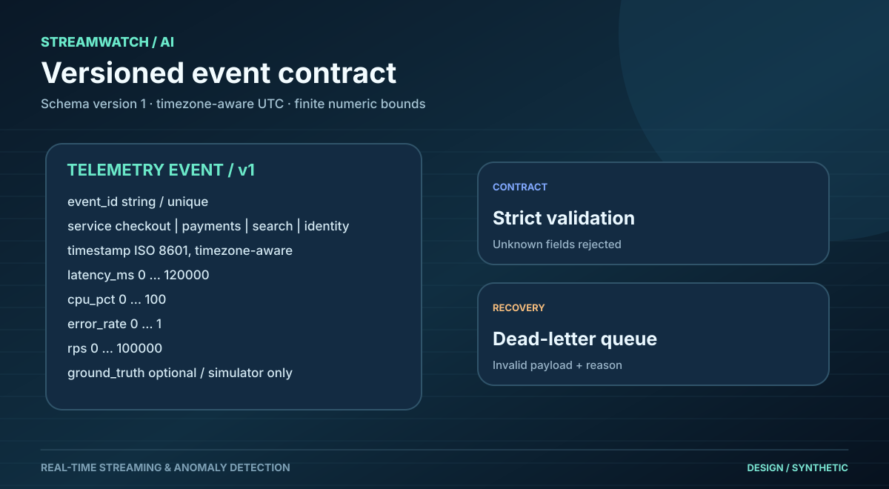
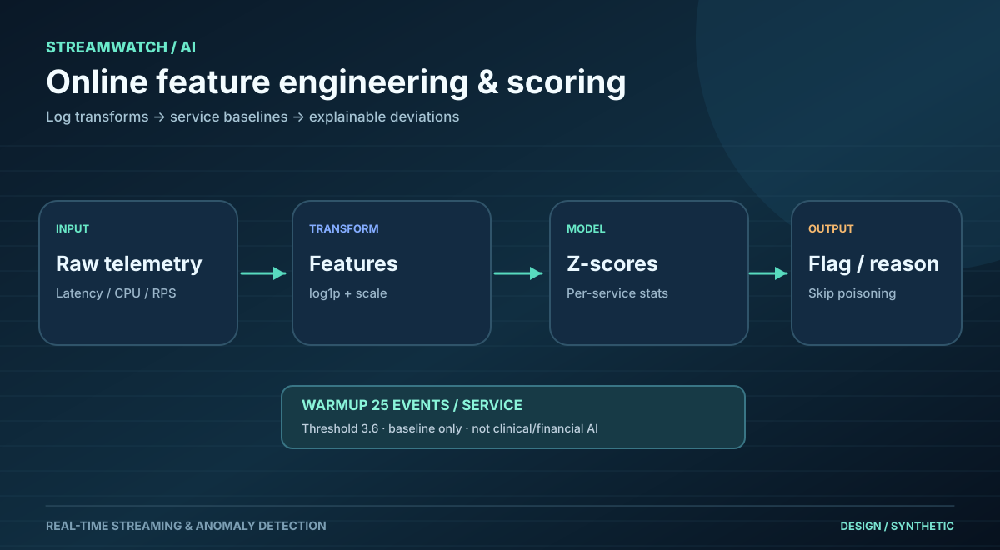
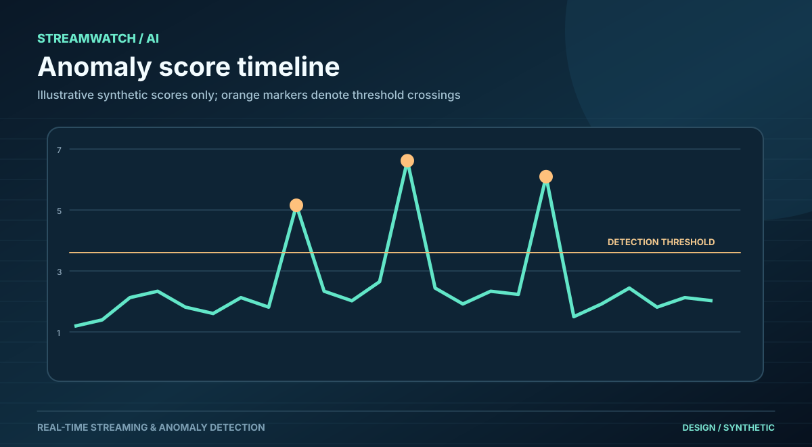
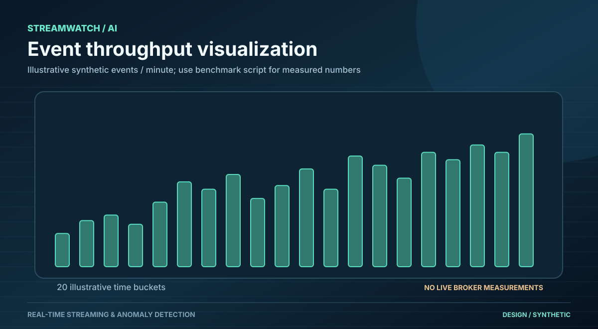
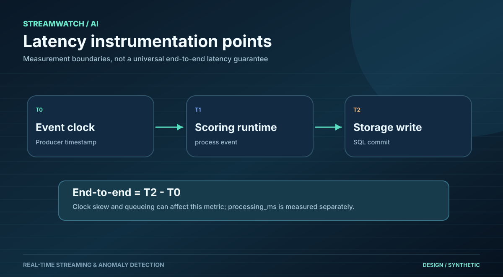
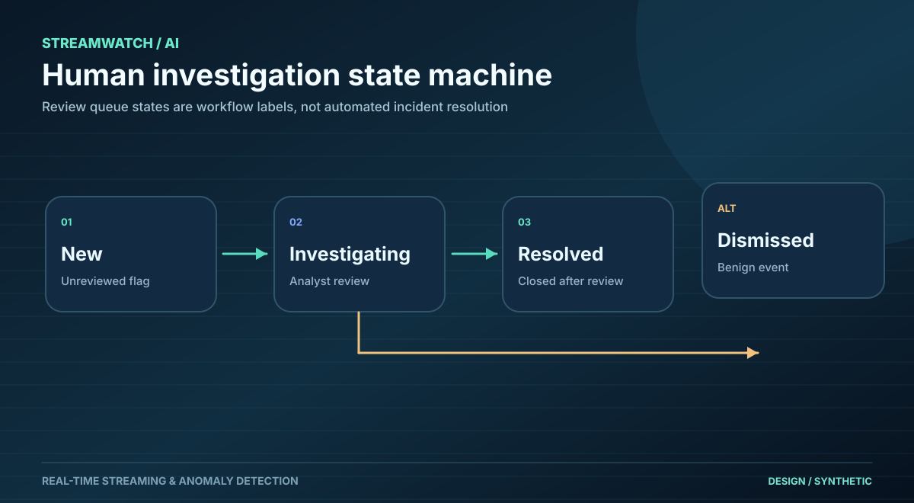
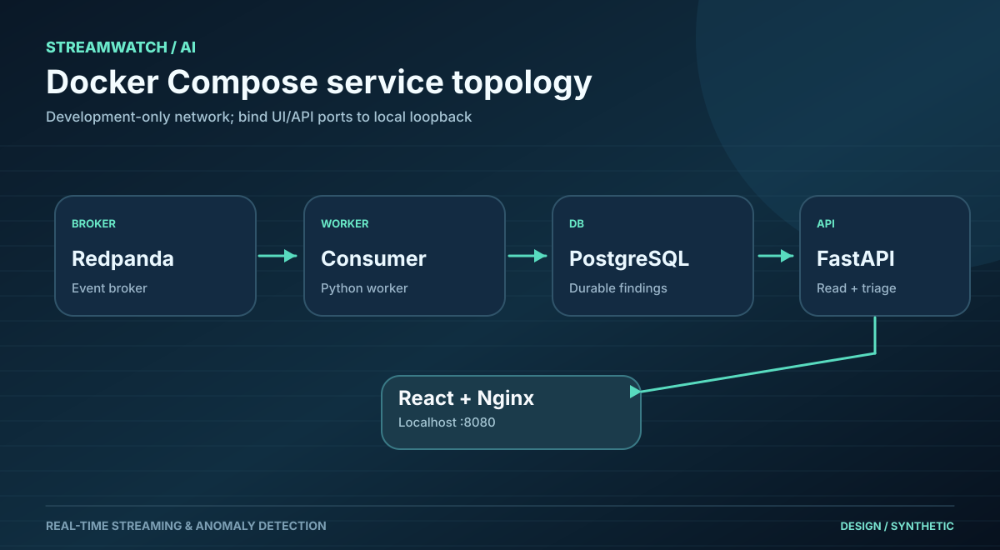

# Ten original vector diagrams and charts

Each SVG is an original editable text/vector asset. Numeric timelines and charts are illustrative/synthetic rather than measured production metrics.

## 1. Project cover

## 2. Pipeline overview

## 3. Kafka topics and DLQ

## 4. Versioned data contract

## 5. Feature transforms and model

## 6. Synthetic anomaly score illustration

## 7. Synthetic event count illustration

## 8. Latency measurement boundaries

## 9. Investigation workflow

## 10. Docker Compose topology

